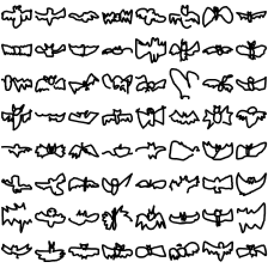
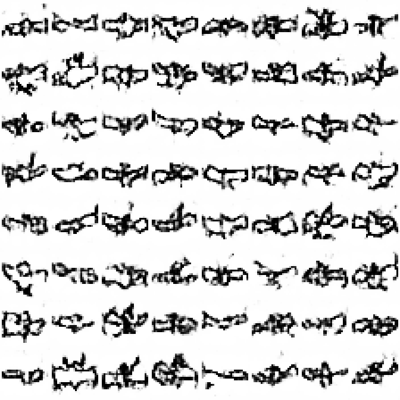

# 🦇 BatGAN Lab

**Una Red Generativa Adversaria convolucional (DCGAN) que aprende a dibujar murciélagos.**

### 👉 Demo: **https://jwagnerpenagos-ai.github.io/batgan-lab/**

> **Categoría usada: `bat` (murciélago)** del dataset [Quick, Draw!](https://quickdraw.withgoogle.com/data) de Google: 20 000 dibujos convertidos a imágenes de 28×28.

| Dibujos reales (Quick, Draw!) | Dibujos generados por la GAN (época 15) |
|:---:|:---:|
|  |  |

---

## ¿Qué tiene el proyecto?

1. **`gan.py`**: el modelo completo en PyTorch, en un solo archivo comentado. Crea la red generadora y la discriminadora, define las funciones de pérdida, entrena y exporta los resultados a `resultados/`.
2. **La página web**, con dos pestañas:
   - **🦇 Resultado** ([`#resultado`](https://jwagnerpenagos-ai.github.io/batgan-lab/#resultado)): los resultados de `gan.py`. Dibujos reales junto a los generados con un deslizador por época, gráficas de pérdidas y de D(x) / D(G(z)), arquitectura de G y D, y los valores de sus pesos con histogramas.
   - **🧪 Laboratorio en vivo** ([`#laboratorio`](https://jwagnerpenagos-ai.github.io/batgan-lab/#laboratorio)): la misma GAN reescrita en TensorFlow.js para entrenarla en el navegador, inspirada en [GAN Lab](https://poloclub.github.io/ganlab/). Tiene hiperparámetros editables, 4 funciones de pérdida, los valores internos de cada capa e interpolación en el espacio latente.

---

## ¿Dónde se crea cada red neuronal?

Todo está en **`gan.py`**, dividido en secciones numeradas:

| Sección | Qué hay |
|---|---|
| **3 · Red Generadora (G)** | `class Generador(nn.Module)` |
| **4 · Red Discriminadora (D)** | `class Discriminador(nn.Module)` |
| **5 · Funciones de pérdida** | `perdida_discriminador()` y `perdida_generador()` |
| **6 · Instanciación** | `G = Generador(...)`, `D = Discriminador(...)` y sus optimizadores Adam |
| **7 · Entrenamiento** | Fase 1 entrena D (con G fijo); fase 2 entrena G (con D fijo) |
| **8 · Exportación** | Imágenes por época, pérdidas, D(x), D(G(z)) y estadísticas de los pesos |

En el laboratorio web, las redes equivalentes se crean en [`js/generador.js`](js/generador.js) (`crearGenerador`) y [`js/discriminador.js`](js/discriminador.js) (`crearDiscriminador`), y las pérdidas están en [`js/perdidas.js`](js/perdidas.js).

---

## Parámetros de las redes

### Red Generadora: 371 937 parámetros

Recibe un vector de ruido **z** de 100 valores ~ N(0, 1) y lo convierte en un dibujo de 28×28.

| Capa | Tipo | Salida | Parámetros |
|---|---|---|---:|
| `densa` | Lineal (sin sesgo) | 3136 | 313 600 |
| `norm1` | Normalización por lotes + LeakyReLU(0.2) | 3136 → mapa 64×7×7 | 6 272 |
| `deconv1` | Conv. transpuesta 5×5, paso 2 | 32×14×14 | 51 200 |
| `norm2` | Normalización por lotes + LeakyReLU(0.2) | 32×14×14 | 64 |
| `salida` | Conv. transpuesta 5×5, paso 2 + **tanh** | 1×28×28 | 801 |

### Red Discriminadora: 55 233 parámetros

Recibe un dibujo de 28×28 y devuelve un **logit**: alto significa "parece real" y bajo, "parece falso". Se cumple que D(x) = σ(logit).

| Capa | Tipo | Salida | Parámetros |
|---|---|---|---:|
| `conv1` | Convolución 5×5, paso 2 + LeakyReLU + Dropout(0.3) | 32×14×14 | 832 |
| `conv2` | Convolución 5×5, paso 2 + LeakyReLU + Dropout(0.3) | 64×7×7 | 51 264 |
| `salida` | Lineal | 1 | 3 137 |

### Hiperparámetros

| Parámetro | Valor |
|---|---|
| Dimensión latente (z) | 100 |
| Tamaño de lote | 64 |
| Optimizador | Adam, tasa 0.0002, β1 = 0.5 (para G y D) |
| Inicialización de pesos | N(0, 0.02), según DCGAN |
| Épocas | 15 (4 680 pasos) |

---

## Funciones de pérdida

Notación: x es un dibujo real, z el ruido, G(z) un dibujo falso y D(·) ∈ (0, 1) la probabilidad de "real".

| Pérdida | Discriminador (L_D) | Generador (L_G) |
|---|---|---|
| **No saturante** (la usada) | −E[log D(x)] − E[log(1 − D(G(z)))] | −E[log D(G(z))] |
| Minimax (GAN original) | igual | E[log(1 − D(G(z)))] |
| LSGAN | ½E[(D(x) − 1)²] + ½E[D(G(z))²] | ½E[(D(G(z)) − 1)²] |
| Wasserstein (solo en el laboratorio) | E[D(G(z))] − E[D(x)] + recorte de pesos | −E[D(G(z))] |

- **D** usa entropía cruzada binaria: quiere D(x) = 1 para los reales y D(G(z)) = 0 para los falsos.
- **G** usa la versión **no saturante**. En la versión minimax, cuando D detecta los falsos con facilidad, el gradiente de G se aplana y G casi no aprende; la no saturante evita ese problema.

---

## Resultados (categoría `bat`)

Entrenamiento de 15 épocas sobre 20 000 dibujos, que tomó unos 5 minutos en CPU:

| Época | Pérdida D | Pérdida G | D(x) | D(G(z)) |
|---:|---:|---:|---:|---:|
| 1 | 0.837 | 1.148 | 0.74 | 0.38 |
| 5 | 1.249 | 0.871 | 0.55 | 0.45 |
| 10 | 1.147 | 1.010 | 0.59 | 0.41 |
| 15 | 1.145 | 1.038 | 0.60 | 0.40 |

**Cómo leerlo:** al inicio D gana con facilidad (D(x) = 0.74 frente a D(G(z)) = 0.38). Luego las dos redes se equilibran, con D(x) ≈ 0.6 y D(G(z)) ≈ 0.4, cerca del 0.5 ideal en el que D ya no puede distinguir. Las pérdidas se estabilizan alrededor de L_D ≈ 1.15 y L_G ≈ 1.04, sin colapsar. La GAN genera siluetas anchas con alas, del mismo estilo que los dibujos de Quick, Draw!.

La evolución completa, época por época, se ve en la [demo](https://jwagnerpenagos-ai.github.io/batgan-lab/) con el deslizador o con el botón "Animar épocas".

---

## Cómo ejecutarlo

### 1. Preparar los datos (ya incluidos en `data/bat_28x28.npy`)

```bash
pip install numpy pillow
python preparar_datos.py --entrada full_raw_bat.ndjson --cantidad 20000
# sin --entrada, descarga el archivo RAW de "bat" directamente de Google
```

El script toma cada dibujo RAW (trazos x, y, t), lo centra y escala en un lienzo de 256×256, dibuja los trazos y lo reduce a 28×28. Solo usa dibujos que el juego reconoció como "bat".

### 2. Entrenar la GAN

```bash
pip install torch numpy pillow
python gan.py                             # 15 épocas, pérdida no saturante
python gan.py --epocas 30                 # más épocas = dibujos más nítidos
python gan.py --perdida lsgan             # probar otra función de pérdida
```

Usa la GPU automáticamente si PyTorch tiene CUDA. Al terminar, los resultados quedan en `resultados/` y la página los muestra.

### 3. Ver la página en local

```bash
python -m http.server 8000                # luego abrir http://localhost:8000
```

---

## Estructura

```
batgan-lab/
├── gan.py                # ← MODELO PRINCIPAL: G, D, pérdidas y entrenamiento (PyTorch)
├── preparar_datos.py     # convierte el RAW .ndjson de Quick, Draw! a imágenes 28×28
├── data/
│   └── bat_28x28.npy     # 20 000 murciélagos 28×28 (uint8)
├── resultados/           # lo que exporta gan.py
│   ├── resultados.js     # pérdidas, D(x), D(G(z)), capas y estadísticas de los pesos
│   ├── modelos.pt        # pesos entrenados de G y D
│   └── img/              # reales.png, epoca_01…15.png, final.png
├── index.html            # página web (pestañas Resultado y Laboratorio)
├── css/estilos.css
└── js/
    ├── resultados.js     # pestaña Resultado: muestra lo exportado por gan.py
    ├── generador.js      # laboratorio: red generadora (TensorFlow.js)
    ├── discriminador.js  # laboratorio: red discriminadora
    ├── perdidas.js       # laboratorio: 4 funciones de pérdida
    ├── entrenamiento.js  # laboratorio: paso de entrenamiento
    ├── datos.js          # carga .npy / .ndjson
    ├── visualizacion.js  # grillas, curvas, histogramas y filtros
    └── app.js            # interfaz del laboratorio
```

---

## Créditos y referencias

- Datos: [The Quick, Draw! Dataset](https://github.com/googlecreativelab/quickdraw-dataset), Google, licencia CC BY 4.0.
- Inspiración del laboratorio: [GAN Lab](https://poloclub.github.io/ganlab/), Kahng et al., Georgia Tech y Google PAIR.
- Teoría: [Curso de Introducción a las GAN, Google for Developers](https://developers.google.com/machine-learning/gan?hl=es-419).
- Goodfellow et al. (2014), *Generative Adversarial Nets*; Radford et al. (2015), *DCGAN*; Mao et al. (2017), *LSGAN*; Arjovsky et al. (2017), *Wasserstein GAN*.

**Autor:** José Felipe Wagner Penagos ([@jwagnerpenagos-ai](https://github.com/jwagnerpenagos-ai)), Ingeniería de Sistemas, Universidad Santo Tomás.
